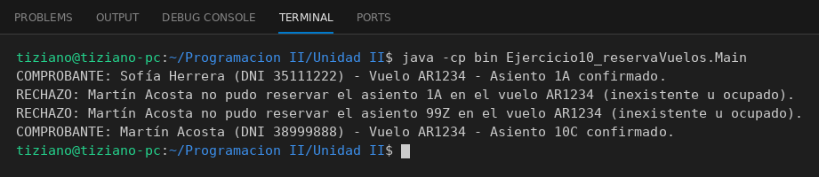

# Vuelo

Programación II - Unidad 2 - Ejercicio 10

## Consigna
Un Pasajero solicita a un Vuelo un asiento; el vuelo valida existencia y disponibilidad antes de confirmar.

## Lógica
- `Asiento` (número, clase, ocupado) y `Vuelo` (código y colección de asientos).
- `Vuelo.reservarAsiento(numero)`: retorna `true` y marca el asiento ocupado solo si existe y está libre.
- `Pasajero.solicitarReserva(vuelo, asiento)`: envía la solicitud e imprime el comprobante o el rechazo.
- `Main`: reserva exitosa, asiento ya ocupado, asiento inexistente y otra reserva exitosa.

## Ejecución

